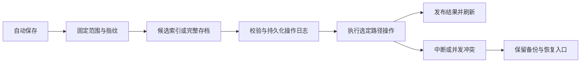

# 提交工作台详细设计

状态：待设计确认，尚未修改应用功能代码。

日期：2026-10-17。代码基线：`72ec09d`。调研依据见 [IDEA 与 Git 调研](2026-10-17-commit-workbench-research.md)。

## 1. 目标与约束

在现有固定提交面板内建设可实际使用的任务变更管理：提交 / 搁置标签、更改列表、目录与模块分组、已忽略文件、文件多选、上下文操作、补丁、可恢复的搁置及最近删除。

继续采用 Electron + React + TypeScript + 本机 Git，优先交付 Windows。保留黑灰暗色液态玻璃、亮色、即时设置、单栏编辑、自动保存、Git 状态颜色及格式过滤；不恢复已删除的工具栏、底栏或提交栏隐藏按钮。

不把截图中的每个菜单项都当成 Git 原生命令。功能必须有真实数据和明确结果，不提供伪执行按钮。

## 2. 三种方案与推荐

| 方案                                                   | 机制                                                                           | 优点                                                  | 成本与限制                                         |
| ------------------------------------------------------ | ------------------------------------------------------------------------------ | ----------------------------------------------------- | -------------------------------------------------- |
| A：保留 Git 暂存语义，增加更改列表及独立 Shelf（推荐） | 复选框仍真实暂存；列表组织文件；明确选择提交范围；Shelf 独立保存补丁和恢复材料 | 兼容现有习惯、外部 Git 与部分暂存；覆盖截图主要工作流 | 列表范围提交需要临时索引；Shelf 需要事务与恢复设计 |
| B：增加 IDEA 式“更改列表模式 / 暂存区模式”切换         | 列表模式下勾选是提交选择，提交时再准备索引；暂存模式沿用现状                   | 更接近 IDEA 两种模式的产品语义                        | 两套勾选含义、迁移和交互，容易与现有暂存行为混淆   |
| C：只增强原生 Git stash                                | 按路径 stash，配合命名、预览和删除                                             | 工程量较小，命令行可操作                              | 不能完整表达截图中的独立搁置、列表和最近删除       |

推荐 A。与 IDEA 的差异会直接体现在产品文案：复选框称“暂存”，列表称“更改列表”，搁置称“搁置”，Git stash 称“Git 储藏”。创建/移动列表不会执行 Git add。

需要确认的架构选择是 A / B / C；推荐 A 的完整边界在下文定义。

## 3. 交付范围

### 3.1 本轮实现

1. 固定提交面板顶部增加“提交 / 搁置”页签，切换时保留提交消息、修订状态及选择。
2. 本地更改列表：新建、改名、说明、设为活动、移动文件、删除列表。
3. 平铺 / 目录 / 模块分组、展开收起、按名称与路径筛选、显示已忽略文件。
4. 文件与分组多选、鼠标右键菜单及键盘上下文菜单。
5. 提交全部已暂存内容、提交指定列表中的已暂存内容、提交所选文件中的已暂存内容。
6. 工作区回滚、删除文件、定位文件、查看工作区/暂存差异、独立只读差异窗口。
7. 创建补丁文件、复制补丁到剪贴板；导出包含所选文件最终内容或仅其暂存内容。
8. 搁置指定已托管文件或整个列表；支持“搁置并移除本地改动”和“仅复制到搁置”。
9. 搁置预览、单项/部分文件恢复、重命名、删除至最近删除、恢复被删除记录、明确确认后永久删除。
10. 原生 Git 储藏继续保留，补齐稳定标识和文件差异预览；与 Shelf 的数据和操作分开。

### 3.2 明确不在本轮实现

- UML 类图：需要代码解析和类型依赖分析，不能用文件关系图冒充。菜单不放置可点击的空壳功能。
- 同一文件的不同代码块分别归属不同更改列表；首版按文件归属，仍保留现有 Git 部分暂存状态。
- 跨多个 Git 仓库的一次事务提交、嵌套仓库聚合、自动检出时智能搁置、IDEA `.idea/shelf` 格式导入。
- 自动三方恢复、自动解决冲突、自动格式化、自动推送、自动执行项目构建或外部检查。
- 任意外来补丁导入向导；本轮实现补丁导出和本应用 Shelf 的恢复。

这些边界属于设计提案，确认设计时可以调整。

## 4. 界面与交互

### 4.1 面板结构

```text
[提交] [搁置]                                  [更多]
刷新  回滚  暂存切换  搁置  查看差异  定位  展开  收起
                         [视图选项：分组、显示忽略]
搜索文件或路径
  更改（活动）                       [混合复选框]
    目录/模块
      文件 A                          M / 部分暂存
  修复任务
    文件 B                            A
  未进行版本管理的文件  数量  浏览
  已忽略文件（按需显示） 数量/浏览
─────────────────────────────────────────────────
[修订] [上次提交] [历史]   提交范围：所有已暂存 / 列表 / 所选文件
提交消息
[提交] [提交并推送…]                          [设置]
```

“搁置”页使用同一位置的列表和工具栏，按“搁置记录 / 已应用 / 最近删除”分组。底部是选中记录的摘要和恢复按钮，不显示提交表单。提交表单组件保持挂载，避免切页清空草稿。

所有标签和工具操作保持紧凑；重复点击、键盘导航和列表展开不加过场动画。模态框、菜单沿用现有 Portal、焦点与减少动效规则。

### 4.2 三种独立状态

- **选中**：蓝/灰背景，用于右键、回滚、补丁、搁置等操作。
- **暂存**：复选框对应真实 Git 索引；部分暂存用横线显示。
- **列表归属**：文件属于哪个更改列表，不影响磁盘和 Git 索引。

单击文件延续当前差异打开行为；Ctrl 点击切换选择，Shift 点击选择可见范围。右键先确定目标选择集合，再弹菜单，不触发复选框。分组复选框只影响该组可操作文件，不影响其他列表。被筛选隐藏的已选文件在操作摘要中明确计数。

### 4.3 上下文菜单

| 对象          | 有效动作                                                                                                                         | 禁用 / 缺省规则                                          |
| ------------- | -------------------------------------------------------------------------------------------------------------------------------- | -------------------------------------------------------- |
| 已托管文件    | 提交所选已暂存内容、暂存/取消暂存、回滚工作区改动、显示差异、独立窗口差异、移动到列表、搁置、创建/复制补丁、删除文件、定位、刷新 | 无相应变更时禁用；冲突文件只允许查看、编辑及解决相关操作 |
| 更改列表      | 提交该列表已暂存内容、新建/编辑/设为活动/删除、暂存该列表、回滚工作区改动、搁置、导出补丁                                        | 内置“更改”列表不允许删除；空列表的数据管理仍可用         |
| 未托管文件    | 加入 Git、打开、删除文件、刷新                                                                                                   | 不直接搁置或导出 Git 变更补丁；提示先加入 Git            |
| 已忽略文件    | 打开、复制路径、定位                                                                                                             | 不参与暂存、提交、列表移动、搁置；不自动强制加入 Git     |
| 搁置记录/文件 | 预览、取消搁置、复制恢复、重命名记录、导出补丁、删除到最近删除                                                                   | 不允许在损坏记录上执行恢复                               |
| 最近删除      | 预览、恢复到搁置、永久删除                                                                                                       | 永久删除需明确确认；不直接应用到工作区                   |

“回滚工作区改动”保留已暂存内容，复用现有语义。“恢复到 HEAD 并清除暂存”仅在明确的完整回滚对话框中提供，并先备份。删除更改列表永不删除文件；删除文件先进入系统回收站或本应用可恢复存储。

### 4.4 快捷键

仅在提交树/搁置树内生效；输入框、编辑器和其他对话框不被全局拦截。

| 快捷键                  | 行为                                        |
| ----------------------- | ------------------------------------------- |
| Ctrl+K                  | 聚焦提交消息，必要时切换到提交页            |
| Ctrl+Enter              | 执行当前范围提交，沿用现有校验              |
| Ctrl+D                  | 查看所选文件差异                            |
| Ctrl+Alt+Z              | 打开回滚确认                                |
| Ctrl+Alt+P / Ctrl+Alt+M | 切换目录 / 模块分组                         |
| F2                      | 编辑当前列表或搁置名称                      |
| Delete                  | 文件删除确认 / 搁置软删除；不是直接清空磁盘 |
| Shift+F10 / Menu        | 打开当前选择的上下文菜单                    |
| Escape                  | 关闭菜单/对话框，并回到原触发项             |

列表和文件名路径可由屏幕阅读器读取；部分暂存用 `aria-checked=mixed`，禁用项具备原因；不只依赖颜色传达状态。

## 5. 更改列表与分组

### 5.1 列表规则

- 保留不可删除的内置列表 `default`，初始名“更改”。任一时刻恰好一个活动列表。
- 新观察到、尚未归属的已托管变更进入活动列表。未托管与已忽略项单独显示。
- 新建列表可填写名称、说明并设为活动；名称去除首尾空白、非空、限制 100 字符且不重名。
- 移动文件只修改归属。改名涉及 `oldPath` 和 `path`，作为同一变更处理。
- 删除普通列表将其文件移动到内置列表；删除活动列表时活动状态回退内置列表。
- 一致的状态刷新确认文件不再有变更后清理其归属；提交后立即刷新。每条路径是文件级成员，不声称跨提交追踪代码块。
- 每个列表保存自己的提交消息草稿；修订草稿保持独立，切换不会被默认说明覆盖。

### 5.2 分组

- 平铺：文件名 + 相对目录，保持当前紧凑行。
- 目录：更改列表 → 目录树 → 文件；共同路径折叠只改变展示。
- 模块：更改列表 → 模块 → 可选目录层 → 文件。
- 模块来源优先使用用户配置的仓库内根路径；其次查找变更文件祖先目录中的 `package.json`、`pom.xml`、`build.gradle(.kts)`、`go.mod`、`Cargo.toml`、`.csproj`。这是本应用的模块识别规则，不等同 IDEA 的项目模型。
- 识别不到时放入“未识别模块”，不把任意第一层目录伪装成模块。路径最长的匹配模块优先。
- 模块读取不执行脚本，不加载项目插件；手动覆盖立即生效并本地保存。

### 5.3 大目录与忽略项

默认不查询忽略项。用户打开“显示已忽略文件”后才启动独立查询，支持取消、加载中、失败重试及分页。优先聚合整目录，展开时再读取子项，避免完整列出 node_modules。

原生查询基于 `git ls-files --others --ignored --exclude-standard -z`，目录汇总使用 `--directory`。忽略项不是 `Change`，不混入待提交计数。未托管文件继续每页 100 项；更改与搁置列表使用扁平化可见树和每批 100 行的加载上限，不能一次展开数万 DOM 节点。

## 6. 提交范围与 Git 索引

### 6.1 范围必须明确

默认“所有已暂存”保持当前行为。选择列表或文件后，只提交该范围内**已经暂存的版本**；不会自动把同一文件尚未暂存的后续编辑带入提交。

确认区显示实际文件清单、来源列表、部分暂存数量、修订状态和推送目标。选择为空不回退成全部。合并/变基/拣选/还原过程中禁用范围提交，沿用 Git 操作继续/中止入口。

### 6.2 指定范围提交算法

不使用 `git commit --only <paths>` 来模拟暂存范围：它可能取工作区内容而不是用户选择的部分暂存版本。

1. 自动保存完成后，串行锁定当前仓库，读取 HEAD 和原索引指纹 `I0`。解析并固定路径集合，重命名两端必须一起处理。
2. 创建临时索引，从当前 HEAD（空仓库用空树）初始化。
3. 只将原索引中所选路径的 stage-0 条目及删除状态写入临时索引，不从磁盘重新 `git add`。
4. 在临时索引中复用现有格式过滤：仅行尾空白、换行格式被排除，缩进仍属于内容改动。没有可提交内容则停止。
5. 获取真实 `index.lock`，再次检查原索引和 HEAD。使用 `GIT_INDEX_FILE` 指向临时索引运行原生 `git commit`，保留 hooks、签名和原生错误。
6. 成功后，以原索引为基础，把实际已提交路径同步到新 HEAD；未提交路径的索引条目保持不变，再发布真实索引并释放锁。工作区字节不改写。
7. 记录已创建的 commit hash。若提交已创建但索引同步失败，返回独立状态 `committed-index-pending`，显示提交编号和恢复入口，禁止把它当“提交失败”自动重试。

原生 hook 可能修改临时索引或工作区，不能承诺任意 hook 均严格服从选定路径。提交结果必须读取实际 commit 的路径并反馈；不能禁用 hook 或在 hook 失败时伪报成功。工作区由 hook 改动时按 Git 原生结果保留。

## 7. Shelf 数据与生命周期

### 7.1 与 Git 储藏分离

Shelf 位于当前 worktree 的绝对 Git 管理目录下 `git-idea/shelves/`。Git worktree 的 `.git` 可能是文件，因此通过 `git rev-parse --absolute-git-dir` 定位，不能直接拼接 `<repo>/.git`。

Git stash 仍来自 `refs/stash`，两者不会互删。Git stash 操作增加对象 ID：执行前从列表引用重新解析 hash，发现位置变化时重新定位或报“记录已变化”，避免 `stash@{0}` 漂移后操作错项。

### 7.2 内容

每个 Shelf 使用 UUID 目录，包含清单、可导出的完整二进制补丁、暂存补丁和用于恢复的原始字节。

```text
<absolute-git-dir>/git-idea/
  workspace.json
  workspace.lock
  shelves/<uuid>/manifest.json
  shelves/<uuid>/working.patch
  shelves/<uuid>/staged.patch
  shelves/<uuid>/snapshots/...
  operations/<uuid>.json
  file-trash/<uuid>/...
```

- 清单保存创建时间、名称、源分支、HEAD、原列表归属、文件状态、前后路径、模式、原索引条目、内容摘要。
- 快照分别覆盖基线、索引版本与工作区原始字节；不存在的路径明确记录为 absent，不等价于空文件。
- UTF-8 文本预览仍限 2 MB；存档支持二进制与较大文件，单文件上限 64 MB、单记录 256 MB。超过限制在移除任何文件前拒绝；补丁生成流式写盘，不通过现有字符串输出上限截断。
- Shelf 保存完整内容，包括灰色格式变化。过滤仅用于 Git 暂存/提交，不可在备份时丢掉用户字节。
- 普通已托管文本、二进制、新增、删除、重命名纳入范围。未托管项提示先加入 Git。首版拒绝冲突、子模块、稀疏检出、符号链接/重解析点和正在进行的 Git 合并类操作；无 HEAD 时允许仅复制备份，禁用清除工作区的搁置。

### 7.3 创建事务

1. 前端完成自动保存，展示最终路径、暂存/未暂存数量及动作“复制”或“移除本地改动”。
2. 服务端在仓库队列内重取状态，检查 HEAD、索引、工作区摘要和文件类型；路径集合不得来自未校验的前端拼接。
3. 写临时 UUID 目录，完成补丁、原始快照和 SHA-256 摘要校验后，发布不可变存档。记录操作日志 `prepared`。
4. “仅复制”到此结束；不改变索引和工作区。
5. “搁置并移除”只处理确认的完整文件变更，恢复这些路径的 HEAD 版本并清除这些路径的暂存；其他路径的索引和工作区保持不变。重命名前后路径一起处理。
6. 每次改写前再次校验相应指纹，变化时停止；存档仍可用。完成后记录 `completed` 并刷新。

先存档后清理，不能先 `restore` 再尝试补丁落盘。磁盘空间不足时不得清理。完整归档只在明确永久删除时移除。

### 7.4 恢复

- 默认将所选搁置文件恢复到工作区，不自动暂存；可在对话框中选择“同时恢复原暂存状态”。
- 选中部分文件只恢复这些文件；重命名涉及的两个路径不可拆开。成功恢复的部分在原记录中标记已应用，剩余部分继续可用。
- “取消搁置”成功后把恢复的文件归入目标列表并移到已应用状态；“复制到工作区”保留活动搁置状态，可重复应用。
- 工作区恢复使用完整补丁；恢复暂存状态使用独立 staged/working 状态。目标版本与保存基线一致时，原始字节快照用于保留原换行和二进制内容。
- 在隔离的候选目录/临时索引中预检所有所选路径，比较当前指纹后执行；原生补丁应用不使用 `--reject` 或 `--unsafe-paths`。默认不静默改用 `--3way`。
- 目标文件有冲突、同名未托管文件或补丁不能应用时，整体拒绝所选批次，保留原搁置；提示用户查看差异、另存恢复内容后手动合并。
- 恢复原暂存状态时，所选目标路径的索引必须干净，其他路径可有暂存内容。成功后只同步所选路径，不清空全局暂存区。

### 7.5 删除与恢复

`active → deleted` 是软删除；最近删除可预览并恢复到 `active`。已应用记录归为 `applied`，也可再次复制恢复。永久删除必须确认，删除范围限定 UUID 存档目录，不根据任意前端路径递归删除。首版不自动过期清理。

## 8. 事务、并发与中断



- Git 写操作复用 `serialize(repo)`，并增加 worktree 级元数据锁，防止两个本应用实例同时修改列表或 Shelf。
- 元数据采用 schemaVersion + revision，临时文件写入后替换；revision 不匹配时重载，不用旧前端状态覆盖新数据。
- Git 索引依然使用原生 `index.lock`；不删除其他程序持有的锁。外部 Git 和外部编辑器不受本应用队列控制，因此发布前还需校验指纹。
- 文件系统与 Git 索引不存在跨资源的单次原子事务。正常预检失败不改写；I/O 中断或崩溃由持久化日志和备份恢复，不能宣称任意失败都完全无副作用。
- 日志包含 operationId、类型、路径集合、HEAD/索引前后摘要、存档位置、已完成步骤，不保存访问令牌。
- 启动发现 `prepared/applying/committed-index-pending` 操作时，显示恢复提示并阻止新的破坏性操作。只有当前文件仍等于本操作写入的版本时才允许自动回滚；已有后续编辑则保留双方材料，由用户选择恢复位置。
- 请求期间切换仓库要取消读取、等待写入结果；结果按 repoId + requestId 校验，不更新另一仓库的列表或消息。

## 9. 补丁、删除与独立差异窗口

### 补丁

补丁生成固定 `--binary --full-index --no-ext-diff --no-textconv`。范围是明确的文件集和“HEAD 到工作区最终内容 / HEAD 到暂存区”；首个提交使用空树。重命名包含两端，所有路径以字面量处理。

保存到文件由受信任的主进程显示系统保存对话框，取消不产生副作用；默认 `.patch`。复制补丁使用系统剪贴板，超过 8 MB 提示改为文件导出。导出不暂存、不回滚、不提交。

### 文件删除

确认显示完整相对路径和数量。Windows 使用系统回收站；开发浏览器使用应用内部可恢复目录。先确认可备份再删除。删除使 Git 显示工作区 D，不自动 `git rm` 暂存；由用户勾选提交。冲突、子模块及链接类文件不进入通用批量删除。

### 独立差异窗口

主进程创建受信任只读窗口，沿用当前主题/缩放和统一单栏差异。窗口由内部 ID 定位差异源，不接收任意 URL；标题显示仓库与文件。只提供受限读取、查找、复制和关闭能力，不允许该窗口调用 mutate、保存文件或更改设置。注册与销毁窗口时同步撤销 IPC 权限。

普通工作区仍在现有可编辑单栏中打开；历史、暂存、Shelf 及独立窗口中的差异一律只读，不增加编辑/手动保存按钮。

## 10. 数据契约

以下类型是接口约束，不是已实现代码。

```ts
type CommitScope =
  | { kind: "all-staged" }
  | { kind: "changelist"; id: string }
  | { kind: "files"; paths: string[] };

type Grouping = "flat" | "directory" | "module";
interface ChangeListRecord {
  id: string;
  name: string;
  description: string;
  builtin: boolean;
}
interface CommitWorkspace {
  schemaVersion: 1;
  revision: number;
  activeListId: string;
  lists: ChangeListRecord[];
  assignments: Record<string, string>;
  view: { grouping: Grouping; showIgnored: boolean };
  moduleRoots: { path: string; name: string }[];
  drafts: Record<string, string>;
}
interface ShelfRecord {
  id: string;
  name: string;
  createdAt: string;
  baseHead: string | null;
  sourceBranch: string;
  state: "active" | "applied" | "deleted";
  deletedAt?: string;
  files: ShelfFile[];
}
interface ShelfFile {
  id: string;
  path: string;
  oldPath?: string;
  status: "added" | "modified" | "deleted" | "renamed";
  binary: boolean;
  applied: boolean;
  listId: string;
  baseSnapshot: string | null;
  indexSnapshot: string | null;
  workingSnapshot: string | null;
  mode: string;
}
interface OperationResult {
  operationId: string;
  state:
    "completed" | "conflict" | "recovery-required" | "committed-index-pending";
  message: string;
  commitHash?: string;
  affectedPaths: string[];
}
```

清单快照标识只在后端解析，不能被前端当磁盘路径读取。文件名、哈希、模式和字节摘要另有后端内部记录；未知 schemaVersion 拒绝写入，不覆盖降级数据。

## 11. API 与文件职责

| 模块                                   | 职责                                                            |
| -------------------------------------- | --------------------------------------------------------------- |
| `shared/commit-workspace.ts`           | 列表、分组、范围、Shelf 与操作结果类型                          |
| `electron/commit-workspace.ts`         | 持久化、revision、列表 CRUD、归属与模块根                       |
| `electron/commit-index.ts`             | 选择范围、临时索引、格式过滤、提交与索引恢复                    |
| `electron/shelves.ts`                  | 存档、快照、预检、恢复、软删除与操作日志                        |
| `electron/patches.ts`                  | 流式补丁、摘要、范围校验及导出                                  |
| `electron/api.ts`                      | 明确的方法分发和参数校验，桌面/开发端共用                       |
| `electron/git.ts`                      | 保留 Git 执行、状态、既有操作；提取可复用索引辅助，避免循环依赖 |
| `electron/main.ts` / `preload.ts`      | 文件保存、回收站、差异窗口与按窗口限制 IPC                      |
| `src/components/CommitPanel.tsx`       | 提交/Shelf 页签和状态容器，不堆积全部业务                       |
| `src/components/CommitTree.tsx`        | 分组、可见行、多选、列表复选框、键盘操作                        |
| `src/components/CommitContextMenu.tsx` | 同一操作模型的右键/工具栏入口与可用性                           |
| `src/components/ChangeListDialog.tsx`  | 列表新建、编辑、移动、目标列表选择                              |
| `src/components/ShelfPanel.tsx`        | Shelf / 已应用 / 最近删除树、预览和恢复                         |
| `src/components/CommitMessage.tsx`     | 草稿、修订、范围预览、提交与结果处理                            |
| `src/components/Editor.tsx`            | 增加只读 Shelf 差异源；保留既有自动保存                         |

新增读取：`commitWorkspace`、`ignoredFiles`、`modules`、`shelves`、`shelfDetail`、`shelfDiff`、`patchPreview`、`operationRecovery`。

新增写入：`changelist.create/update/delete/activate/move`、`commit.view`、`commit.scope`、`shelf.create/apply/rename/delete/restore/purge`、`operation.recover`。写入走同一串行调度和自动保存前置，不再由渲染器自行先后调用多个裸 Git 命令。

原生桥增加：`savePatch`、`copyPatch`、`openDiffWindow`、`trashFiles`。这些接口只接受仓库、已验证范围与内部 ID，不开放任意 shell、任意 URL 或任意文件读取。

## 12. 状态与失败反馈

| 场景                    | 处理                                               |
| ----------------------- | -------------------------------------------------- |
| 无仓库/无改动           | 页面保留、显示明确空态；新建列表需仓库             |
| 保存失败                | 保留草稿、阻止提交/搁置/回滚，不继续操作旧磁盘内容 |
| 用户取消导出/确认       | 原数据不变，不显示失败通知                         |
| HEAD/索引/文件变化      | 提示状态变化并刷新；不自动重试破坏性动作           |
| 补丁冲突                | 保留 Shelf，显示冲突路径，可查看差异/另存内容      |
| hook/签名失败           | 显示 Git 错误，保留消息和选择，不重写提交          |
| 已提交但后处理失败      | 显示真实提交 hash 与恢复入口，禁止重复提交         |
| 元数据损坏              | 保留原文件和备份，进入只读恢复，不覆盖为空列表     |
| 磁盘满/存档写入失败     | 不开始清理工作区                                   |
| 搁置文件不存在/摘要不符 | 标记记录损坏并禁用应用；其他记录仍可用             |
| Git stash 引用漂移      | 基于对象 ID 重新定位；找不到时停止                 |

错误在当前面板或操作对话框内显示，包含失败阶段与可采取动作。现有通知用于完成摘要，不依赖已删除的底部状态栏。

## 13. 实施顺序与验收场景

先完成设计确认，再使用 writing-plans 细化为逐项实施任务；实现按下列可独立审阅的提交推进。

1. 元数据、列表模型与分组纯逻辑。
2. 提交树、多选、菜单、视图选项与忽略项读取。
3. 提交范围、临时索引、草稿与结果状态。
4. 补丁与 Shelf 后端、事务日志及恢复入口。
5. Shelf 前端、部分恢复、最近删除。
6. 原生补丁导出、文件回收、独立只读差异窗口。
7. 串接自动保存、Git 储藏稳定标识、文档与 Windows 打包。

每批项目改动创建本地 Git 提交，不推送。当前仅完成调研和设计，不运行或新增测试；以下是后续可执行的验收场景清单，不能当作已通过结果。

| 场景                             | 必须满足的结果                                  |
| -------------------------------- | ----------------------------------------------- |
| 文件部分暂存后再编辑             | 范围提交取暂存版本；后续编辑留在工作区          |
| A/B 列表都已暂存，只提交 A       | 新提交只含 A；B 的暂存字节和状态保留            |
| 初次提交/重命名/删除             | 空树基线正确，重命名两端不遗漏                  |
| 中英文、空格、括号、前导减号路径 | 以字面量和 NUL 路径传递，不变成选项或通配符     |
| 列表删除/文件移动                | Git 索引和磁盘均不变化                          |
| Shelf 仅复制                     | 工作区、索引、格式字节不变                      |
| Shelf 移除、恢复原索引           | 可恢复暂存和未暂存的不同版本，其他文件不变      |
| 恢复时目标文件冲突               | 当前批次不部分成功，不丢失 Shelf                |
| 删除 Shelf 再恢复                | 最近删除可恢复全部材料；永久删除只处理指定 UUID |
| CRLF、行尾空格、缩进、二进制     | Shelf 原样保存；提交只过滤已约定的格式差异      |
| 外部 Git/编辑器并发、应用中断    | 检测指纹变化，保留日志与双方内容，提供恢复      |
| 19,000 个未托管项/大忽略目录     | 按需读取和分页，默认不扫描所有忽略文件          |
| 明暗、70%/100%/200%、窄窗口      | 两页签与范围选择可用，提交栏仍固定显示          |
| hook 失败、签名失败、推送失败    | 正确区分未提交/已提交/未推送，不重复创建提交    |
| 切换仓库/重启                    | 列表、草稿、分组、Shelf 隔离且持久保留          |

## 14. 设计确认点

建议确认方案 A，并接受以下明确语义：复选框仍是真实暂存；列表按文件归属；范围提交只取已暂存版本；Shelf 与 Git stash 分开；UML 和文件内代码块级列表归属不纳入本轮。

设计确认后，再生成逐任务实施计划并开始代码。若选择方案 B，需要先补充两种提交模式的迁移与默认模式设计。
